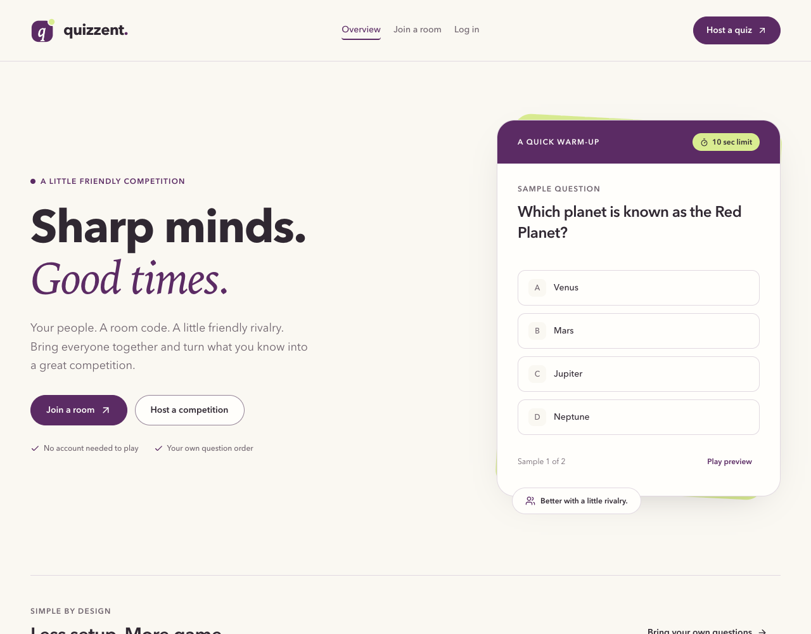
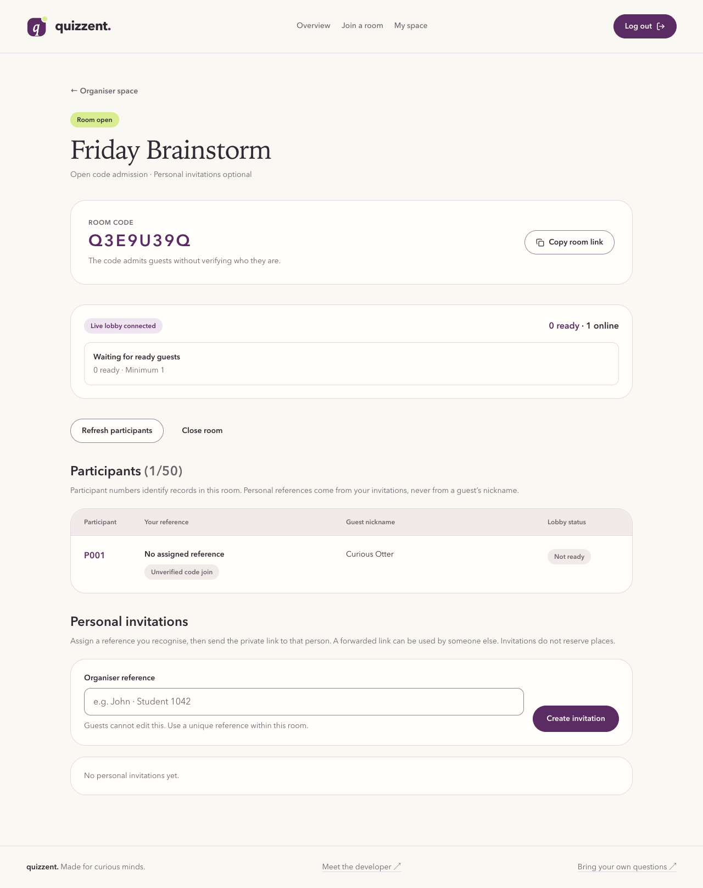
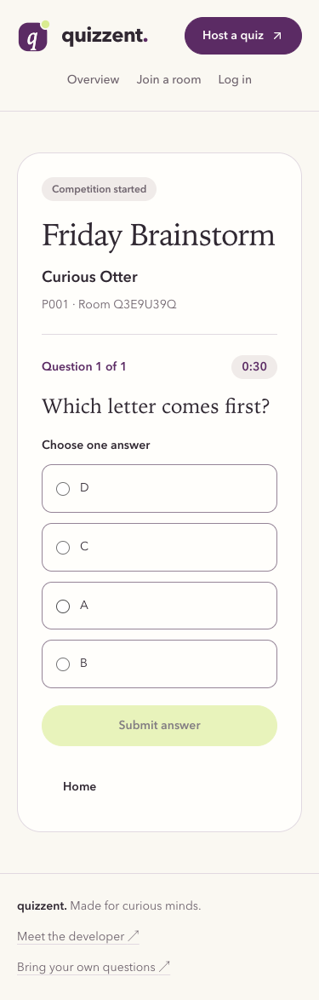
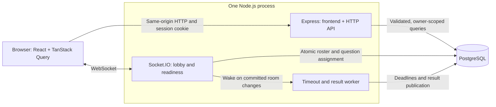

# Quizzent

Real-time quiz competitions with server-controlled timing, guest participation and saved results.

Built with **React, TypeScript, Express, PostgreSQL and Socket.IO** as a learning and portfolio project. Organisers publish MCQs, invite guests into a live lobby, and follow their progress. Guests need no account: each gets a private session and a stable participant record, separate from their nickname.

**Live demo:** [quizzent-076x.onrender.com](https://quizzent-076x.onrender.com) — hosted on Render Free with Neon Free PostgreSQL. Free services can sleep; open the demo before presenting. See the [deployment checks and limits](docs/deployment.md).

## In the app



| Organiser room | Guest question |
| --- | --- |
|  |  |

Screenshots use disposable test data from the running application.

## Features

- Organiser signup/login, private draft library, four-option MCQ editing and immutable publication.
- Open room codes or personal invitations, unique room nicknames, stable participant numbers and organiser references.
- Live readiness with distinct guest counts across tabs, configurable lobby minimums and a five-second start warning.
- Persisted question/option shuffles, per-question deadlines, immutable answers, safe retries and reconnect/timeout progression.
- Shared-rank leaderboards and private answer reviews after everyone finishes; explicit cancellation and server-restart recovery.
- Superadmin directory, filters/pagination, password-verified sensitive changes, suspension and hosting restrictions/weekly limits.
- Responsive plum/citron UI, shared controls, accessible notifications and keyboard-aware dialogs.

## Architecture



PostgreSQL holds accounts, hashed session/invitation secrets, competitions, room membership, assignments, answers and results. Lobby presence and request budgets live in memory, so this MVP runs **one backend process**. The worker stops polling when there are no running competitions.

The browser countdown is display only. The server samples database time after locking an attempt, resolves an answer or timeout once, and advances progress in the same transaction. A request ID makes an accepted submission safe to retry. Room locks and unique constraints protect concurrent admission, capacity and hosting quotas.

## Run locally

Use the Node.js version in `.node-version` and PostgreSQL 18 (Postgres.app works on macOS).

1. Clone this repository and run `npm ci`.
2. Copy `server/.env.example` to `server/.env` and configure your **local** `DATABASE_URL`. Keep it out of version control.
3. Start PostgreSQL, then run `npm run db:migrate`.
4. Run `npm run dev:server` in one terminal and `npm run dev` in another. Open Vite's printed URL.

Create an organiser at `/signup`, log in, create a draft, add questions and publish it. Open a room, then use a separate browser profile to join by code and mark yourself ready. Superadmin provisioning is a separate local command, not a public signup role: [admin guide](docs/superadmin-controls.md).

The API defaults to `127.0.0.1:3001`; `GET /api/health` checks the process, not PostgreSQL. Vite proxies `/api` and `/socket.io` during development. Production Express serves the built frontend on the same origin. [Database setup](docs/postgresql-setup.md) · [Authentication](docs/authentication.md) · [Competition lifecycle](docs/competition-runtime.md)

## Verification

| Command | Checks |
| --- | --- |
| `npm run build` | Production React assets and compiled server |
| `npm run lint` | Static code checks |
| `npm run test:server` | 81 schema, API, security, concurrency, timing and hosting checks |
| `npm run test:load` | Real HTTP/WebSocket scenarios with 30 and 50 competitors |
| `npm run test:browser` | Edge desktop/touch flows, axe scans, built-frontend smoke check and screenshots |
| `npm run test:hosted` | Explicit HTTPS origin, security smoke and 30/50 competitor scenarios |
| `npm run test:hosted:browser` | Hosted organiser/guest UI, production cookies, CSP and accessibility |

Database checks use disposable PostgreSQL schemas; run them against a development database. Browser checks use installed Edge by default; set `BROWSER_CHANNEL=chrome` or `BROWSER_EXECUTABLE` for another compatible installed Chromium browser. Build first so the built-frontend check can find `dist/`.

The latest local deployment-preparation scenarios completed with **no errors at 30 or 50 competitors**. At 50 competitors, answer-submission p95 was **25 ms**: 95% of sampled submissions finished within that time. All 50 deliberately unanswered final questions timed out and produced the expected saved results. This is a short local scenario on Node 26.5.0 with a five-connection PostgreSQL pool, not a hosted capacity or availability claim. The [hardening report](docs/mvp-hardening.md) preserves the original Step 18 measurements and security review.

Hosted on 2026-11-23: the browser-HTTP/Socket.IO scenario completed with zero errors at 30 and 50 competitors; 50-competitor answer p95 was **1,086 ms**. This is an end-to-end test from one client machine, not server-only latency or a capacity guarantee. Earlier Node HTTP runs were slower and the 50-competitor run missed deadlines; the [deployment report](docs/deployment.md#hosted-evidence--2026-11-23) records both results.

## Deployment and limits

The ₹0 demo uses one Render Free web service and Neon Free PostgreSQL. `render.yaml` configures manual releases, a health check, migrations before startup and secret injection. See [deployment instructions and hosted evidence](docs/deployment.md); free services can sleep or suspend at quota limits.

Published competition content is frozen through the API. Guest names are not verified identities. A copied session cookie is a bearer credential until expiry/revocation. This MVP does not provide MFA, password recovery, distributed rate limits, proctoring or validated multi-room hosted capacity. Restarting/redeploying during a running quiz cancels it by design; deploy between competitions.

## Code and documentation

```text
src/app/                     Routing, providers and application shell
src/components/              Generic UI and layout primitives
src/features/<feature>/      Feature components, pages, API calls and hooks
src/styles/                  Named colour tokens and shared base styles
server/src/features/         Auth, competitions, rooms, lobby, attempts, results, admin
server/migrations/           Versioned PostgreSQL schema changes
server/tests/                Isolated database/API and regression checks
server/checks/               Load scenarios and browser walkthrough
```

Generic components do not import feature code. Runtime input is validated separately from TypeScript types. Changes normally use focused feature-branch commits and reviewed pull requests.

- [Development plan](docs/development-plan.txt)
- [Schema and migrations](docs/database-schema.md)
- [Frontend design and component conventions](docs/frontend-design.md)
- [Deployment and operations](docs/deployment.md)
- [Resume wording, demo flow and interview notes](docs/portfolio.md)

Developed by [ahmxd18](https://github.com/ahmxd18). The footer currently links to this profile; it can point to the professional portfolio once that site is deployed.
